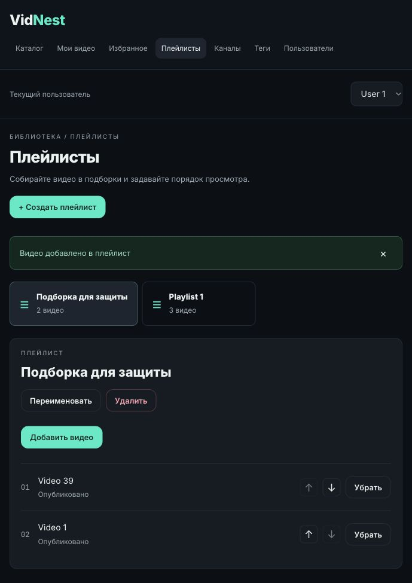

# Интерфейс и API для всех сущностей ЛР3

Состояние: 02.11.2026, ветка `lab-3`. Приложение: http://localhost:5173 . Все операции интерфейса обращаются к NestJS API; сущности и связи сохраняются в PostgreSQL. Локально браузер хранит только выбранный demo-профиль.

## Разделы приложения

### Каталог

Публичные published-видео с названием канала, автором, размером и тегами. Есть поиск, фильтр канала и «Показать ещё» с курсорной пагинацией. Из карточки можно открыть плеер, добавить видео в избранное или свой плейлист. Внешняя ссылка необязательна: без неё показываются метаданные.

### Мои видео

Все статусы видео своих каналов, включая draft и hidden. В форме канал выбирается по названию, теги — флажками; знать ID не требуется. Создание по-прежнему резервирует квоту и создаёт draft.

Можно изменить название, описание, набор тегов, внешнюю ссылку и comments_enabled; опубликовать или скрыть видео. Смена метаданных и тегов выполняется атомарно. Пустая ссылка очищает playback_url. comments_enabled — настройка, отдельная подсистема комментариев не добавлена.

Канал и размер после создания неизменяемы. storage_key и даты создаёт сервер; published_at сохраняет момент первой публикации. Удаления видео нет согласно правилам ЛР3.

### Избранное

Отдельный список текущего пользователя, повторное добавление безопасно. Скрытое видео не возвращается. Можно открыть ролик, убрать его из избранного или добавить в подборку.

### Плейлисты

Создание, переименование и удаление своих подборок, просмотр состава, добавление видео по поиску в публичном каталоге или своих видео. Стрелки вверх/вниз меняют порядок; «Убрать» удаляет только связь, само видео остаётся.

В плейлист можно включить published-видео любого автора и свой draft/hidden. Если чужое видео скрыто после добавления, вместо его названия показывается «Недоступное видео», которое можно убрать. Чужой приватный title/status не раскрывается.

Изменения состава блокируют родительскую строку playlists через FOR UPDATE. Перестановка проверяет, что переданы все текущие videoIds ровно один раз. Чистая таблица связей пересобирается в транзакции с позициями 1..N; это исключает временный конфликт UNIQUE позиций при обмене двух элементов. Максимум 1000 видео на плейлист. Параллельные добавления не теряют записи.

### Каналы

Просмотр владельца, числа видео, занятой/общей/оставшейся квоты. Для своего канала доступны переименование и создание нового. Квота задаётся строкой bigint при создании и затем не редактируется через API. Использованные байты показываются без преобразования в неточный Number; процент полосы — только округлённая визуализация.

Удалить можно только свой пустой канал. FK RESTRICT защищает канал с видео даже при прямом запросе API. Не выполняется каскадное удаление каталога.

### Теги

Общий справочник: создание, нормализация trim/lowercase, переименование и удаление неиспользуемых тегов. В учебном demo-режиме любой существующий demo-пользователь может изменять общий справочник. Это явное правило совместной учебной среды, не система ролей production.

Переименование отражается во всех видео по FK. Удаление используемого тега отклоняется, чтобы не снимать чужую классификацию молча. Набор тегов своего видео меняется в редакторе.

### Пользователи

Список учебных профилей и переключение текущего пользователя. Можно создать новый профиль, изменить имя/email своего, удалить свой профиль, если нет каналов/плейлистов и это не последний пользователь. FK защищают связанные данные; избранное удаляемого пользователя удаляется CASCADE.

Созданного пользователя с ID больше 6 можно выбрать сразу. Заголовок X-Demo-User проверяется на положительный integer и существование записи в users. Demo-режим по-прежнему разрешён только при DEMO_AUTH=true и NODE_ENV=development/test. Аутентификация токенами не реализована.

## Дополнительные API

Все операции изменения требуют X-Demo-User существующего пользователя. Контекст владельца всегда берётся из заголовка, не из ownerId тела. Публичные чтения /videos, /channels, /tags не требуют пользователя.

- `GET /users` — список учебных профилей (требует demo-контекст).
- `POST /users` — `{displayName,email}`, создать профиль, 201.
- `PATCH /me` — `{displayName,email}`, изменить свой профиль, 200.
- `DELETE /me` — удалить свой профиль, 204; при зависимостях или последнем профиле 409.
- `GET /channels` — канал, ownerId/ownerName, quotaBytes/usedBytes/remainingBytes, videoCount.
- `POST /channels` — `{title,quotaBytes}`, создать свой канал, 201.
- `PATCH /channels/:id` — `{title}`, переименовать свой канал, 200.
- `DELETE /channels/:id` — удалить свой пустой канал, 204; непустой 409.
- `GET /tags` — `{id,name,videoCount}` для всех тегов.
- `POST /tags` — `{name}`, создать тег, 201; повтор нормализованного имени 409.
- `PATCH /tags/:id` — `{name}`, переименовать, 200.
- `DELETE /tags/:id` — удалить неиспользуемый тег, 204; используемый 409.
- `PUT /videos/:id/tags` — `{tagIds:[...]}`, заменить набор тегов своего видео, 200.
- `GET /me/videos` — `{items,nextCursor}` для своих видео всех статусов. q/channelId/limit/cursor как у каталога, порядок created_at DESC,id DESC.
- `GET /me/playlists` — свои плейлисты с itemCount.
- `POST /me/playlists` — `{title}`, создать, 201.
- `GET /me/playlists/:id` — свой плейлист с упорядоченными items; чужой при чтении 404.
- `PATCH /me/playlists/:id` — `{title}`, переименовать, 200.
- `DELETE /me/playlists/:id` — удалить плейлист и его связи, 204; видео остаются.
- `POST /me/playlists/:id/items` — `{videoId}`, добавить доступное видео в конец, 201; повтор не создаёт дубль.
- `PUT /me/playlists/:id/order` — `{videoIds:[...]}`, задать полный порядок, 200.
- `DELETE /me/playlists/:id/items/:videoId` — убрать видео и уплотнить позиции, 200 с обновлённым плейлистом. Повтор безопасен.

Существующий `POST /videos` дополнительно принимает optional playbackUrl/commentsEnabled; `PATCH /videos/:id` — playbackUrl/commentsEnabled/tagIds. При неизвестном теге редактирование откатывается целиком. Обязательные channelId/title/sizeBytes/tagIds и запрет менять размер/канал сохранены.

Карточка видео содержит tags, комментарии-настройку, даты и ссылку воспроизведения. Избранное дополнительно содержит channelId, author и playbackUrl.

## Диагностика и ошибки

ValidationPipe отклоняет лишние поля и неверные типы. Именованные ограничения FK/UNIQUE/CHECK остаются в БД. Для дополнительных операций QueryFailedError преобразуется по PostgreSQL-коду: дубль 409, недопустимая ссылка/значение 400, защищённое удаление 409. Неизвестная ошибка — 500 с внутренним диагностическим логом, текст SQL клиенту не отдаётся.

Глобальный guard делает проверку существования пользователя для запросов с X-Demo-User. Поэтому у авторизованного HTTP-чтения есть дополнительный SELECT контекста. Сам метод выборки каталога по-прежнему делает 2 SQL для непустой страницы независимо от 5 или 20 видео; публичный каталог без заголовка не требует запроса guard.

## Проверки

Фактический [integration.log](evidence/integration.log): **25 passed, 0 failed**. Помимо исходных 18 сценариев добавлены:

19. Создание пользователя с id>6, нормализация email, свой профиль, дубли, неизвестный/удалённый demo-пользователь, FK-защита удаления.
20. Каналы: точный большой bigint, владение, переименование, запрет смены квоты, удаление пустого и защита непустого.
21. Теги: нормализация, уникальность, переименование, удаление неиспользуемого и защита связей.
22. Приватный список своих видео: все статусы и полный обход курсора.
23. Атомарное редактирование метаданных/тегов, commentsEnabled, playbackUrl, очистка URL, неверный протокол, право владельца.
24. Полный цикл плейлиста, повтор добавления, приватность, проверка состава при перестановке, позиции после удаления, защита владельца.
25. Параллельное добавление двух видео и отсутствие утечки метаданных чужого скрытого ролика.

Также прошли unit smoke-тест, backend/frontend build и линтеры. Docker Compose обновлён без сброса основной базы.

## Проверка в браузере

Через реальный интерфейс выполнены: создание «Подборка для защиты», добавление Video 1 и Video 39, перестановка Video 39 на первую позицию; переключение на User 2 показало его собственный Playlist 2. Создано и опубликовано «Видео для защиты интерфейса» с размером 4096 байт, выбранными tag-1/tag-2 и внешней MP4-ссылкой. Эти новые демонстрационные записи оставлены в рабочей базе; прежние записи пользователя сохранены.

## Короткий сценарий для защиты

1. В верхнем поле выбрать demo-пользователя.
2. В «Каналы» создать свой канал с лимитом.
3. В «Теги» добавить осмысленные метки.
4. В «Мои видео» создать draft, выбрав канал и теги по названиям; проверить расход квоты в «Каналы».
5. Отредактировать описание/теги/ссылку и нажать «Опубликовать».
6. В каталоге добавить видео в избранное и плейлист.
7. В «Плейлисты» добавить второй ролик, поменять порядок стрелками.
8. Переключить пользователя: свои черновики и плейлисты другого профиля не появятся.

Служебные поля id, owner_id, used_bytes, storage_key и временные метки не вводятся вручную. Интерфейс представляет все восемь таблиц через предметные действия, сохраняя ограничения исходной лабораторной.
