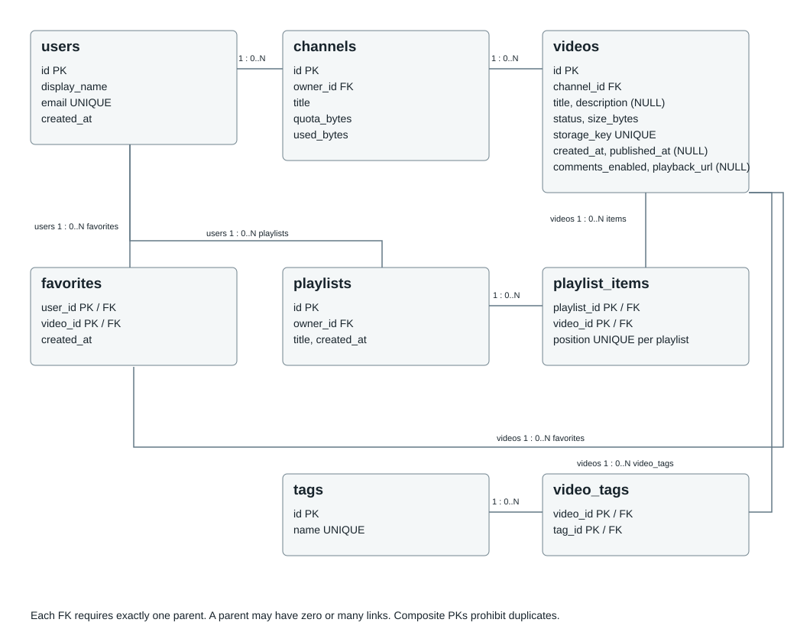

# Лабораторная работа №3. База данных видеохостинга VidNest

Автор: Коноваленко Максим. Дата выполнения: 02.11.2026.

## 1. Цель и исходное состояние

Цель — заменить хранилище ЛР2 реляционной базой PostgreSQL, обеспечить целостность метаданных, атомарное резервирование квоты и воспроизводимые проверки конкурентного доступа. Работа выполнена в ветке `lab-3`, созданной от `lab2-docker`, commit `4e04fef7af201eaacb7b40d6d8ca289aa2cf5e81`. Эта ветка включает `lab2` (`99636d1`) и Docker-конфигурацию; локальной или известной remote-ветки `lab-2` на момент начала работы нет. Рабочее дерево перед началом было чистым.

В ЛР2 видео записывались в JSON-файл, избранное находилось в памяти процесса. Это не обеспечивало общую транзакцию между сущностями, ограничения FK и защиту от конкурирующих записей. В ЛР3 обе подсистемы переведены на PostgreSQL. Файловый seed и тесты старого формата заменены DB seed и интеграционными HTTP/SQL-сценариями; предыдущая реализация доступна в истории Git.

Хранятся метаданные и условный storage_key. Загрузка файлов, транскодирование, CDN, платежи и реальная система комментариев не реализуются. Существующий React-клиент адаптирован к новому контракту каталога, формы и избранного; публикация, редактирование, теги, каналы, пользователи и плейлисты доступны через интерфейс как расширение обязательной части.

## 2. Трассировка требований SRS

Источник идентификаторов — существующая заметка Obsidian `Projects/vidnest-srs-lr1.md`, SRS ЛР1. Исходные идентификаторы сохранены. Уточнения ниже применяются к объёму ЛР3 и не заменяют весь SRS.

- **3.1.1, каталог.** Сценарий: гость получает опубликованные видео с каналом и автором. Таблицы videos/channels/users/video_tags/tags; `GET /videos`, SQL 1 и 12. Проверка: только published, порядок даты и id, полный обход курсора. Изменение: вместо произвольного status-фильтра публичная выдача всегда published; ответ `{items,nextCursor}`.
- **3.1.2, карточка.** Сценарий: гость читает published, владелец — также свои draft/hidden. Таблицы videos/channels/users; `GET /videos/:id`. Проверка: 200 для доступного, 404 для чужого draft и отсутствующего. Изменён путь `/video` → `/videos`.
- **3.1.3, создание.** Владелец создаёт метаданные в своём канале с тегами и квотой. Таблицы channels/videos/video_tags/tags; `POST /videos`. Проверки успеха, неизвестного тега, нехватки квоты, отката и гонки. Уточнение: исходный processing заменён на draft; URL/длительность/формат не требуются для условного storage_key.
- **3.1.4, валидация.** title 3–100 после trim, description до 1000, sizeBytes — положительная десятичная строка до максимума bigint, tagIds — уникальные существующие положительные integer. Проверки DTO и CHECK/FK. Старый предел 2 ГБ снят для учебной проверки bigint; фактический лимит — квота канала.
- **3.1.5, поиск.** Поиск опубликованных видео по подстроке title, `GET /videos?q=...`, SQL 3. Символы `%`, `_`, `\` трактуются как литералы и экранируются. Поиск по теме/автору исходного SRS отложен: темам соответствуют общие теги, обязательный SQL ЛР3 требует поиск по title.
- **3.1.6, редактирование.** Владелец меняет title/description, `PATCH /videos/:id`. Таблицы videos/channels; проверка 403 для чужого видео, неизменности размера/канала и 400 на лишние поля.
- **3.1.7, статусы.** `PATCH /videos/:id/status` принимает published/hidden. draft создаётся только через POST. Первая публикация устанавливает published_at; повторная сохраняет дату. Исходные processing/blocked заменены на draft/hidden. Проверяется право владельца и удаление hidden из публичных ответов.
- **3.1.8, избранное.** PUT/DELETE `/me/favorites/:videoId`, GET `/me/favorites`; таблицы favorites/videos/channels. Составной PK и ON CONFLICT исключают дубль при гонке; повтор DELETE даёт 204. Связь с hidden может оставаться в БД, но не возвращается публично.
- **3.3.3 и 3.5.4, хранение.** Вместо гарантии «до перезапуска» используется сохранение PostgreSQL. Проверка закрывает приложение, создаёт новый DataSource/процессный контекст Nest и повторно читает созданную запись.

История просмотров 3.1.9 и рекомендации 3.1.10 остаются в плане развития. Плейлисты проверяются SQL и ограничениями; дополнительно реализованы API и интерфейс, см. [interface.md](interface.md).

## 3. Предметные правила и доступ

Пользователь владеет 0..N каналами, канал имеет одного обязательного владельца, видео — один обязательный канал. Владелец определяется из контекста запроса, поля ownerId в DTO нет. Размер после создания и физическое удаление видео через API не поддерживаются. Все статусы расходуют квоту.

Для демонстрации используется `X-Demo-User` с id существующего пользователя (в seed 1–6), только при `DEMO_AUTH=true` и `NODE_ENV=development` либо `test`. Это выбор заранее созданного пользователя, а не аутентификация. Без заголовка запись требует 401; при выключенном demo или production попытка использовать его даёт 403. Публичный каталог и публичная карточка доступны без demo-контекста. Compose привязывает учебные порты к 127.0.0.1. Пароль учебный, не предназначен для внешней среды.

Публикацию и изменение метаданных разрешает проверка владения channels.owner_id. FK обеспечивает существование пользователя/канала, но не полномочия. Роли администратора и настоящие токены не добавляются в этой работе.

## 4. Модель и словарь данных



Редактируемая модель: [schema.mmd](schema.mmd); читаемая векторная версия: [schema.svg](schema.svg). Каждая ссылка на родителя обязательна (NOT NULL), со стороны родителя допустим ноль дочерних строк. M:N представлены video_tags, favorites и playlist_items. PK у таблиц связей составной; position уникален внутри плейлиста, одно видео не повторяется в одном плейлисте.

Полный [словарь всех столбцов](data-dictionary.md) фиксирует смысл, PostgreSQL-тип, nullability, default, ограничения и допустимый пример. Идентификаторы — integer identity. Байты — bigint, в JSON десятичная строка. Даты — timestamptz(3), в JSON ISO 8601 UTC: миллисекундная точность совпадает с JavaScript Date и не обрезает курсор.

Nullable поля: description, published_at и необязательный playback_url. У опубликованного видео published_at обязателен. У draft даты публикации пока нет; hidden сохраняет прежнюю дату, если она была. Столбец comments_enabled добавлен отдельно с NOT NULL DEFAULT true и пока не означает реализацию комментариев.

## 5. Практическая нормализация

Исходная ненормализованная форма (семь строк; несколько тегов в одной ячейке):

```text
video_id | video_title | channel_id | channel_title | owner_id | owner_name | tags
1        | Video 1     | 1          | Channel 1     | 1        | User 1     | tag-1, tag-2
8        | Video 8     | 1          | Channel 1     | 1        | User 1     | tag-8, tag-9
15       | Video 15    | 1          | Channel 1     | 1        | User 1     | tag-3, tag-4
2        | Video 2     | 2          | Channel 2     | 2        | User 2     | tag-2, tag-3
9        | Video 9     | 2          | Channel 2     | 2        | User 2     | tag-9, tag-10
3        | Video 3     | 3          | Channel 3     | 3        | User 3     | tag-3, tag-4
4        | Video 4     | 4          | Channel 4     | 4        | User 4     | tag-4, tag-5
```

Аномалия обновления: переименование User 1 требует согласованно менять три строки. Если изменить только video_id=1, один владелец получит противоречивые имена. Аномалия вставки: невозможно завести Channel 8 без выдуманного видео. Аномалия удаления: удаление единственного Video 3 уничтожит сведения о Channel 3 и User 3. Поиск и уникальность отдельных тегов внутри строки также неудобны.

Функциональные зависимости:

- video_id → channel_id, title, description, status, size_bytes, storage_key, даты;
- channel_id → owner_id, title, quota_bytes, used_bytes;
- owner_id → display_name, email, created_at;
- tag_id → name;
- (playlist_id, video_id) → position;
- (user_id, video_id) → created_at для избранного.

1НФ: теги вынесены в строки tags и video_tags, в одном столбце один скалярный факт для операций поиска/связи. 2НФ: у составных ключей свойства относятся ко всей связи, position не является глобальным свойством видео. Имена видео/тега не копируются в video_tags. 3НФ: название канала и имя владельца вынесены из videos, поскольку зависят от других неключевых атрибутов через channel_id/owner_id. Изменение имени выполняется одним `UPDATE users SET display_name=$1 WHERE id=$2` и отражается через JOIN.

used_bytes — специально сохранённый агрегат. Его источник истины: сумма size_bytes всех videos канала. CHECK одной строки проверяет 0 ≤ used ≤ quota, но не равенство сумме другой таблицы. Равенство поддерживает транзакционный сервис; SQL 10 и интеграционная проверка сверяют результат. Прямой DML с размером или удалением видео вне алгоритма может нарушить равенство, поэтому таких методов в API нет. Привилегированный администратор БД остаётся за границей гарантий приложения.

## 6. Ограничения и политика удаления

Все таблицы имеют именованные PK/FK, бизнес-уникальность обеспечивают UNIQUE, допустимые значения — CHECK вместе с NOT NULL. Нормализованные email и tag.name проверяются самой БД: нижний регистр, trim, непустое имя. email дополнительно содержит @; это учебная нормализация, не полная RFC-проверка адреса.

users → channels и playlists, channels → videos используют RESTRICT: нельзя случайно удалить владельца с каналами или канал с каталогом. Чистые связи video_tags, favorites, playlist_items удаляются CASCADE при удалении родителя, потому что без него не имеют смысла. Удаление тега снимает классификационную связь, а не удаляет видео. Удаление плейлиста удаляет только его элементы. Пользователь с одним избранным без каналов может быть удалён со своими связями; пользователь-владелец канала защищён RESTRICT.

UNIQUE storage_key не связан с идемпотентностью избранного. FK video_tags.tag_id с ошибкой 23503/fk_vt_tag превращается в 400 «Unknown tag». Неизвестные ошибки не маскируются под пользовательский конфликт: Nest возвращает 500 и пишет диагностику. DTO не заменяет ограничения БД, что подтверждают прямые SQL-проверки.

## 7. Окружение и миграции

Фактически использованы PostgreSQL 17.11 (aarch64, alpine), Node.js 26.2.0 на рабочей машине, NestJS 12.0.1, TypeORM 1.1.2, pg 8.23.1. Точные зависимости и транзитивные версии фиксирует package-lock.json. Dockerfile использует Node 22 Alpine; Compose — PostgreSQL 17 Alpine. Для повторения измерений важны версии из evidence/plans.json.

Миграция Initial создаёт восемь таблиц с ограничениями. Comments добавляет comments_enabled с true для существующих строк. Indexes добавляет три индекса под продуктовые запросы. Дополнительная миграция Playback сохраняет необязательный playback_url и переносит внешнюю ссылку двух published-демороликов ЛР2 в уже заполненную базу. synchronize=false; приложение не пересоздаёт схему по моделям. Миграции выполняются отдельной командой до старта backend, результат сохраняется в служебной таблице migrations.

Для демонстрации изменения заполненной схемы создана отдельная vidnest_migration_test. В ней применена исходная схема, загружены 40 видео, затем добавлен comments_enabled. Все строки сохранены и получили true. После установки false у video 1 столбец удалён down-миграцией и добавлен заново: число видео осталось 40, значение вернулось к true. Значит, rollback столбца теряет прежние настройки, хотя не удаляет видео. Реальный журнал: [evidence/migration.json](evidence/migration.json).

vidnest_test отделена от vidnest разработки; vidnest_measure хранит расширенный набор и результаты EXPLAIN. Команда измерений сбрасывает только две явно названные одноразовые базы (vidnest_measure и vidnest_migration_test), не рабочую. Интеграционный запуск требует URL с именем базы, заканчивающимся на `_test`, и восстанавливает fixture перед каждым тестом.

## 8. Учебные данные

Seed не использует случайность. Последовательности generate_series и фиксированные даты дают одинаковый набор при каждом запуске на чистой схеме. Если users уже заполнена, seed прекращается с явной ошибкой, не перезаписывая данные. Вымышленные адреса используют example.test.

Малый набор: 6 пользователей, 8 каналов, 40 видео, 12 тегов, 78 video_tags, 6 плейлистов, 15 playlist_items, 30 favorites. Видео распределены по семи каналам; канал 8 пустой. Пользователь 6 без избранного. Плейлист 6 пустой. Видео 40 без тегов, но это draft; поэтому SQL 7 о published без тегов возвращает пустой результат. Каждое пятое видео draft, каждое кратное семи (кроме draft) hidden, остальные published. Даты публикации равны, что создаёт обязательный сложный случай курсора.

Расширенный набор дополнительно создаёт 300 каналов и 10 000 видео с тремя тегами на каждое. Итого 308 каналов, 10 040 видео, 30 078 video_tags. Половина расширенных видео сосредоточена в канале 9, остальные распределены по другим каналам. Это неравномерное распределение существенно для оценок планировщика. Квота расширенных каналов достаточна; used_bytes после seed вычисляется по сумме всех статусов.

Канал гонки не входит в набор измерений: каждый тест создаёт отдельный канал quota=104857600 и used=0. Перед независимым сценарием весь малый fixture восстанавливается, поэтому гонки не искажают каталог или планы.

## 9. Двенадцать SQL-запросов и ожидаемые результаты

Файл [queries.sql](../../maxim-nest-project/sql/queries.sql) содержит 12 пронумерованных запросов с вопросом, параметрами и единицей результата. Скрипт measure.mjs исполняет их с параметрами драйвера; фактический полный вывод находится в [queries-small.json](evidence/queries-small.json).

Ожидания зафиксированы независимо от проверяемого SQL:

1. Каталог, limit 5: id **39, 38, 37, 36, 34**, только published, с каналом и автором.
2. Published канала 1: **36, 29, 22, 8, 1**.
3. Поиск `%Video 1%`: published среди 1 и 10–19, с сортировкой по id при одинаковых датах; точные строки в JSON.
4. Канал 8 остаётся в LEFT JOIN, published_count **0**.
5. Избранное по пользователям 1..6: **6, 6, 6, 6, 6, 0**.
6. Популярные теги от пяти published: HAVING применяется после группировки, единица — тег.
7. Published без тегов: **пусто**; единственное полностью без тегов видео 40 — draft.
8. Плейлист 1 пользователя 1: video **1, 2, 3** в position 1,2,3, включая фактический статус.
9. Публичное избранное пользователя 1: **6, 4, 3, 2, 1**; draft 5 исключён.
10. Разница stored−actual у всех восьми каналов **0**, в том числе у пустого.
11. Добавление пары (6,1) создаёт одну связь; повтор add ничего не вставляет; remove удаляет, повтор remove пуст.
12. После курсора (2026-09-01T12:00:00.000Z,39), limit 5: **38, 37, 36, 34, 33**.

Не менее шести ожиданий проверяются явными константами в measure.mjs; они не вычисляются повторением проверяемого SQL. Для запроса 11 действие — параметр add/remove, с непересекающимися условиями двух DML CTE. Не используется склейка значений пользователя с SQL.

## 10. Два разбора JOIN

Если `v.status='published'` находится в ON LEFT JOIN channels→videos, все восемь каналов остаются, канал 8 получает count(v.id)=0. При переносе фильтра в WHERE NULL справа не удовлетворяет сравнению, поэтому каналы 7 и 8 исчезают: в канале 7 все видео hidden или draft. Для конкретного канала 8 COUNT(*)=1, COUNT(v.id)=0. Если канал содержит лишь скрытые/черновые записи, он также исчезнет при WHERE.

В seed у видео 1 два тега и пять пользователей в избранном. Чтобы показать именно 2×3, выбираем поднабор favorites user_id IN (1,2,3). Совместный JOIN даёт шесть сочетаний: (tag1,user1), (tag1,user2), (tag1,user3), (tag2,user1), (tag2,user2), (tag2,user3). COUNT(*)=6 считает сочетания, а не теги или пользователей. COUNT(DISTINCT tag_id)=2 и COUNT(DISTINCT user_id)=3 отражают разные единицы. Для агрегата по всем видео удобнее сначала отдельно сгруппировать video_tags и favorites по video_id, затем соединить два результата. Демонстрационные SQL и фактический вывод сохранены отдельным приложением evidence/join-analysis.json.

## 11. Архитектура доступа и API

DatabaseModule экспортирует один DataSource на процесс, ограничивает пул четырьмя соединениями и закрывает его при остановке. Контроллеры принимают HTTP и DTO, сервисы выполняют сценарии; TypeORM DataSource/manager выступает адаптером доступа, SQL и QueryBuilder остаются явно видны. Выделение отдельного generic repository для каждого простого запроса не требуется: граница доступа — DI-провайдер DataSource и transaction manager.

TypeORM управляет транзакциями/миграциями/построением UPDATE, pg выполняет протокол и преобразование типов, PostgreSQL обеспечивает хранение, блокировки, ограничения и планы. Стиль намеренно SQL-oriented: JOIN и агрегаты проще сопоставить с требованиями лабораторной. Внутри транзакции не используется обычный DataSource.query.

Пул: максимум 4 соединения приложения; интеграционный запуск один. Во время управляемой гонки заняты две сессии и одна диагностическая, что укладывается в пул. Ожидание соединения ограничено 5 секундами, SQL — 10, row lock — 5; в тесте lock_timeout=3 секунды. При нескольких backend-процессах общий бюджет умножается на их число и требует резерва для миграций/psql.

Операции:

- POST /videos → 201, собственный канал, новый draft, server-generated UUID storage_key.
- GET /videos → 200, `{items,nextCursor}`, q/channelId/limit/cursor, только published.
- GET /videos/:id → 200 или 404 по правилам видимости.
- PATCH /videos/:id → 200, title/description; чужой объект 403.
- PATCH /videos/:id/status → 200, published/hidden; первоначальный publishedAt сохраняется.
- PUT /me/favorites/:id → 204, только published, повтор безопасен.
- DELETE /me/favorites/:id → 204, только своя связь, повтор безопасен.
- GET /me/favorites → 200, published с channelTitle, один JOIN-запрос.

Global ValidationPipe использует transform, whitelist и forbidNonWhitelisted. Размер строковый, идентификаторы integer, limit 1..100, путь разбирается числовым pipe. Статус нельзя передать в POST, канал/размер нельзя изменить PATCH. Карточка содержит id/title/status/sizeBytes/createdAt/publishedAt/channelId/channelTitle/author/playbackUrl; каталог дополнительно получает tags пакетным запросом. Ответ не раскрывает storage_key или owner_id.

## 12. Транзакционный алгоритм

Инвариант: для каждого канала `0 ≤ used_bytes ≤ quota_bytes` и `used_bytes = SUM(size_bytes)` всех его videos.

Сервис проверяет границы bigint, открывает транзакцию, получает канал и проверяет владельца. Затем атомарно выполняет UPDATE channels SET used_bytes=used_bytes+size WHERE id=channel AND owner_id=user AND quota_bytes-used_bytes>=size. Проверяется result.affected, а не предположение о форме raw RETURNING. Ноль строк даёт 409. После успешного UPDATE вставляются видео и связи с тегами, затем формируется карточка и выполняется COMMIT.

Если FK тега нарушен после уже вставленных видео и первой корректной связи, transaction callback выбрасывает ошибку. TypeORM выполняет ROLLBACK и возвращает соединение. В тесте до/после сравниваются число видео, число связей и used_bytes: все совпадают. Ошибка вызывается через обычный неверный tagId, отдельного публичного «сломать транзакцию» endpoint нет.

При Read Committed конкурирующий UPDATE ждёт освобождения строки канала. После COMMIT первого PostgreSQL повторно проверяет условие на изменённой версии строки. Так остатка уже недостаточно и второй не проходит. После ROLLBACK первого исходная квота остаётся доступной. Предварительный SELECT выбирает HTTP-ответ для отсутствующего/чужого канала; квоту защищает именно условный UPDATE.

Транзакция содержит только операции БД. COMMIT не гарантирует сохранение реального объекта или запуск транскодирования. Эти будущие действия потребуют outbox и идемпотентного worker, а не сетевого вызова под блокировкой строки.

## 13. Конкурентная проверка

Исходные данные: новый канал, quota=104857600, used=0, видео нет. Два одновременных POST создают разные UUID storage_key, каждый sizeBytes=83886080. Фактически получены **201 и 409**, в канале одно видео, used_bytes=**83886080**. Уникальность storage_key не маскирует ошибку квоты.

Управляемая проверка арендует две сессии. Первая удерживает UPDATE. Вторая отправляет такой же UPDATE и ждёт; третья диагностическая команда подтверждает pg_stat_activity.wait_event_type='Lock'. Только после наблюдения ожидания первая завершается. При COMMIT число изменённых строк второй равно **0**, при ROLLBACK — **1**. Если второй UPDATE успешен, он вставляет видео и фиксируется; иначе откатывается. Равенство used_bytes сумме видео проверяется в обоих вариантах, соединения освобождаются в finally.

Это доказывает наличие ожидания row lock, а не случайное последовательное исполнение Promise.all. Ожидания ограничены таймаутом. В сценарии HTTP дополнительно проверены фактическая запись и квота.

## 14. Курсор, теги и N+1

Курсор — base64url JSON с at и id, где at — ISO-строка publishedAt, id — integer. Первая страница не содержит cursor-предиката. Следующая использует `(published_at,id)<($date,$id)` и тот же ORDER BY DESC. channelId/q сохраняет клиент. Неверный курсор даёт 400. base64 не является подписью или механизмом доступа; безопасность обеспечивает обязательный status='published'.

Весь малый набор имеет одинаковую дату, поэтому сортировка по id необходима. Тест проходит каталог страницами по 5 и сравнивает весь список с ожидаемым полным порядком, проверяет отсутствие повторов. Даты timestamptz(3) не теряют микросекунды при Date.

Сначала одним JOIN выбирается страница videos+channel+owner с LIMIT. Затем одним запросом WHERE video_id=ANY(ids) загружаются теги. Для 5 видео наблюдалось **2 SQL**, для 20 — **2 SQL**. Пустая страница требует только одного. LIMIT не применяется к размноженному JOIN тегов, поэтому состав страницы не обрезается. Promise.all для отдельных запросов не используется как «исправление N+1».

Курсор не создаёт снимок БД между HTTP-запросами. Новое видео до курсора не повторит уже выданные строки; скрытие может убрать ещё не выданную строку. Гарантия полного обхода относится к неизменному набору.

## 15. Индексы и реальные планы

Рассмотрены и добавлены миграцией:

- ix_catalog: videos(published_at DESC,id DESC) WHERE status='published' — сразу публичный порядок и LIMIT без отдельной сортировки.
- ix_channel: videos(channel_id,created_at DESC,id DESC) — равенство канала и упорядоченная страница.
- ix_favorites: favorites(user_id,created_at DESC,video_id DESC) — пользователь и порядок избранного; существующий PK(user_id,video_id) не даёт этот порядок по дате.

Дополнительные индексы увеличивают место и стоимость INSERT/UPDATE. В измеренной БД размер ix_catalog **270336 байт**, ix_channel **425984**, ix_favorites **16384**. PK/UNIQUE уже индексированы и не дублируются. FK сами не создают индекс на дочернем столбце. Для ILIKE '%...%' B-tree не заявляется как универсальное ускорение.

Эксперимент изолирован в vidnest_measure: один расширенный seed, одинаковые SQL, параметры и limit=20; индексы удалены down-методом Indexes, затем добавлены up-методом. На каждой фазе ANALYZE и три последовательных EXPLAIN (ANALYZE, BUFFERS, FORMAT JSON). Используются только SELECT. Полные деревья с estimated/actual rows, loops, buffers и sort находятся в [plans.json](evidence/plans.json).

Каталог: до индекса Limit→Sort→Seq Scan, времена **1.671 / 1.664 / 1.536 мс**; после Limit→Index Scan ix_catalog, **0.027 / 0.017 / 0.014 мс**. Канал 9: до Limit→Sort→Seq Scan, **1.228 / 1.194 / 1.201 мс**; после Limit→Index Scan ix_channel, **0.033 / 0.019 / 0.019 мс**.

Эти цифры относятся к конкретной локальной учебной БД с прогретым кэшем и не являются общей гарантией производительности. Не сравнивается один холодный запуск с одним тёплым. На маленькой таблице Seq Scan может быть оптимальным; индексы оправданы фактическим ограниченным упорядоченным чтением расширенного набора. Детальный разбор узлов и буферов: [plan-analysis.md](plan-analysis.md).

## 16. Проверки и доказательства

В [database.integration.mjs](../../maxim-nest-project/test/database.integration.mjs) автоматизированы все 16 пунктов задания и дополнительные проверки управляемой блокировки, ссылок воспроизведения, профилей, каналов, тегов и плейлистов. Фактический журнал [integration.log](evidence/integration.log): **25 passed, 0 failed, 0 skipped**. Запуск последовательный, без test.concurrent и дополнительных воркеров. Сборка завершается до тестового процесса; линтер и другие тесты одновременно не запускаются.

Каждый тест начинает с TRUNCATE и малого seed в отдельной базе. Успех создания проверяет теги и точную разницу квоты. Неверный DTO и тег, недостаток квоты и ошибка после UPDATE сравнивают состояние до/после. Гонка избранного проверяет одну пару после двух 204. Повтор удаления проверяет сохранение чужой пары. Изменение чужого видео не меняет title. Скрытие проверяется в каталоге и избранном. Размер `9007199254740993` проверяется точной строкой, не Number.

Проверка миграции подтверждает обновление заполненной схемы и потерю отдельного значения после rollback/reapply. SQL ожидаемые ответы сравниваются константами. JOIN-ошибки демонстрируются отдельно. Планы — фактические, не оценочные числа из лекции.

Полный Docker Compose был собран с npm ci и запущен; каталог, избранное и React-клиент ответили HTTP 200. Подтверждение — [docker-smoke.json](evidence/docker-smoke.json), журнал сборки — [docker.log](evidence/docker.log). Backend и frontend проходят сборку и линтер, отдельный smoke-тест контроллера также успешен. Устаревший vite-tsconfig-paths удалён: его peer dependency TypeScript 5 мешала чистой установке при TypeScript 6, а paths-алиасы проект не использует.

Команды запуска, восемь curl-примеров и ограничения тестовых баз приведены в корневом README. Для защиты достаточно показать миграции, каталог, создание/публикацию, SQL 10, интеграционный лог гонки и пары планов до/после.

## 17. Вывод и ограничения

База готова для дальнейшего развития учебного видеохостинга: сущности нормализованы, связи защищены ограничениями, квота и создание атомарны, подтверждены откат и конкурентный доступ, данные переживают перезапуск, каталог имеет устойчивый курсор и фиксированное число запросов.

Гарантии квоты относятся к сервисному алгоритму. Прямой привилегированный SQL вне него может рассогласовать used_bytes; для расширения модели понадобятся контроль прав БД или триггерный путь записи. POST /videos не имеет idempotency key: повтор после потери ответа может создать новое видео и повторно занять квоту. Избранное идемпотентно. Demo-режим не предназначен для внешнего использования. Для видео 1 и 2 сохранён плеер по внешней ссылке из ЛР2 (playbackUrl). Загрузка и хранение файлов, auth, история и рекомендации остаются дальнейшей работой.

## 18. Источники

1. Предоставленная лекция «04-lecture-full.pdf», темы SQL, ORM, NestJS, транзакций, индексов и проверки гонки.
2. Предоставленная лекция «TS .pdf», архитектура библиотек, runtime-границы и совместимость контрактов.
3. Задание «ЛР3 ВРЭФ — База данных видеохостинга.md», предоставлено пользователем.
4. SRS ЛР1, Obsidian Projects/vidnest-srs-lr1.md; идентификаторы использованы в трассировке.
5. [PostgreSQL 17: Transaction Isolation](https://www.postgresql.org/docs/17/transaction-iso.html), Read Committed и повторная проверка WHERE после конкурентного UPDATE, проверено 02.11.2026.
6. [TypeORM: Transactions](https://typeorm.io/docs/advanced-topics/transactions/); форма affected дополнительно проверена реальным вызовом установленного TypeORM 1.1.2 и тестами проекта.

## Дополнение: демонстрационные видео из ЛР2

Два опубликованных ролика старого seed повторно используются через необязательный playback_url. Миграция обновляет существующие записи small/1 и small/2 без пересоздания БД; seed устанавливает ту же ссылку на чистой базе. Клиент показывает HTML5-плеер при наличии playbackUrl, иначе обычную карточку метаданных. Ссылка внешняя, её доступность зависит от samplelib.com; прежние duration 120/90 не перенесены, поскольку ссылка ведёт на 5-секундный образец. Размер квоты остаётся учебным размером метаданных. В расширенном интерфейсе playbackUrl дополнительно принимается через POST/PATCH, допускается только http/https. Исходные планы производительности в приложении были сняты до этого дополнения; оно не меняет ключи, статусы, число строк и порядок выдачи.

## Дополнение: все сущности через интерфейс и API

Реализованы семь разделов с переключением существующих demo-профилей. Восемь таблиц представлены предметными действиями: пользователи, каналы, видео, теги/связи, плейлисты/порядок и избранное. Квота задаётся при создании канала, used_bytes изменяет только транзакция. Размер/канал видео и серверные поля не редактируются; физического удаления видео нет. Состав плейлиста меняется под блокировкой родительской строки, metadata/tagIds редактируются атомарно. Общий справочник тегов доступен всем участникам локальной demo-среды; свои каналы/плейлисты/видео защищены проверкой владельца.

Список API, права, ограничения и результаты 25 тестов: [interface.md](interface.md). Проверка в браузере подтверждена скриншотом и созданными демонстрационными записями. Проверка контекста пользователя добавляет один SQL к запросам с X-Demo-User; непосредственно выборка страницы каталога по-прежнему требует два SQL.
